# Assignment 6. jQuery: Selectors, Effects, Animations

**Name:** Arlan Narushev  
**Group:** IT-2513

**GitHub Pages:** https://eew33.github.io/web6/  
**Repository:** https://github.com/EEw33/web6

This is my personal portfolio page made with HTML, CSS and jQuery 3.7.1. Every block on the page is one task of the assignment (the task number is written next to the block title).

## Project structure

```
assignment6-jquery/
├── index.html      page structure
├── style.css       styles
├── script.js       all jQuery code, divided by tasks
├── images/         pictures for the gallery
├── screenshots/    screenshots for this report
└── README.md       this report
```

---

## Part 1. Getting Started with jQuery

### Task 0. Setup

**Task:**
- Include jQuery from a CDN.
- Write a `$(document).ready(function() { ... })` function.
- Test by printing *"jQuery is ready!"* in the console.

**What I did:** I connected jQuery from the official CDN before my `script.js` file (jQuery must be loaded first, because `script.js` uses `$`). All my code is inside `$(document).ready()`, so it runs after the page is loaded. It prints "jQuery is ready!" in the console and also shows it at the bottom of the page.

```html
<script src="https://code.jquery.com/jquery-3.7.1.min.js"></script>
<script src="script.js"></script>
```

```js
$(document).ready(function () {
  console.log("jQuery is ready!");
  $("#jquery-status").text("jQuery is ready!");
});
```

**Screenshot:**

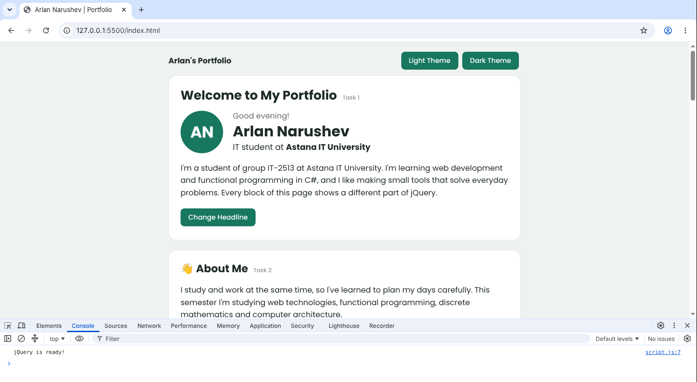

### Task 1. Selectors & CSS

**Task:**
- Display your name, a personal headline, and a short introduction.
- Include a profile section with a title such as "Welcome to My Portfolio."
- Use tag, ID, and class selectors to select different HTML elements.
- Dynamically update your greeting or headline using `.text()` or `.html()`.
- Use `.css()` to change the styling of selected elements.
- Add buttons to switch between light and dark themes.

**What I did:**
- The profile block has the title "Welcome to My Portfolio", my photo, name, headline and a short introduction.
- The greeting changes with the time of day (Good morning / Good afternoon / Good evening). It is set with `.text()`.
- The **Change Headline** button shows the next headline. Headlines have `<b>` tags inside, so I use `.html()`.
- The **Light Theme** and **Dark Theme** buttons change colours with `.css()`. Here I use a tag selector (`$("body")`) and a class selector (`$(".card")`). ID selectors are used everywhere for buttons, for example `$("#dark-btn")`.

```js
$("#greeting").text(greeting);                  // ID selector + .text()
$("#headline").html(headlines[headlineIndex]);  // .html()

$("#dark-btn").click(function () {
  $("body").css({ "background-color": "#121715", "color": "#e3ebe7" }); // tag selector
  $(".card").css("background-color", "#1c2420");                        // class selector
});
```

**Screenshots:**

Light theme:

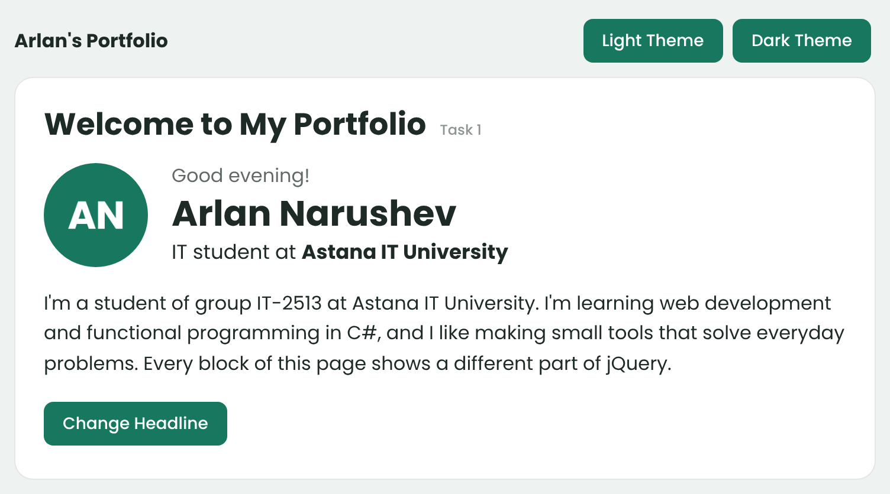

Dark theme, after clicking **Dark Theme** and **Change Headline**:

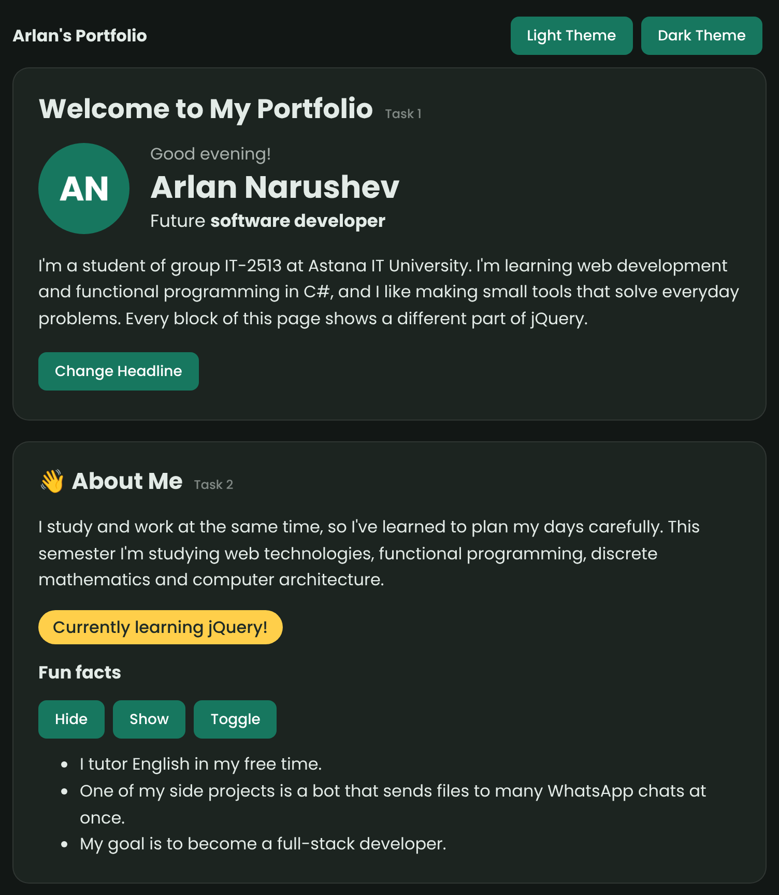

---

## Part 2. jQuery Effects

### Task 2. Visibility Methods

**Task:**
- Create an "About Me" section.
- Add a short biography and a current status message, such as "Currently learning jQuery!"
- Include a few fun facts about yourself, your interests, or your goals.
- Add three buttons: **Hide, Show, and Toggle.**
- Use the buttons to control the visibility of your status message or fun facts.

**What I did:** the About Me block has a short bio, the status "Currently learning jQuery!" and three fun facts. The **Hide**, **Show** and **Toggle** buttons control the fun facts list. `"slow"` makes the effect animated.

```js
$("#hide-btn").click(function () {
  $("#fun-facts").hide("slow");
});
$("#show-btn").click(function () {
  $("#fun-facts").show("slow");
});
$("#toggle-btn").click(function () {
  $("#fun-facts").toggle("slow");
});
```

**Screenshots:**

Before:

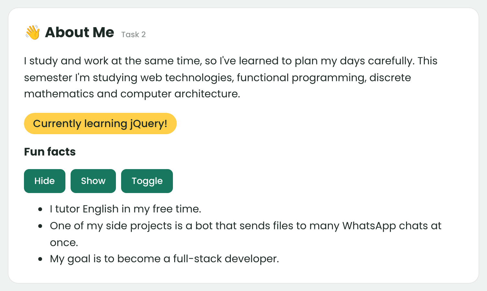

After clicking **Hide**:

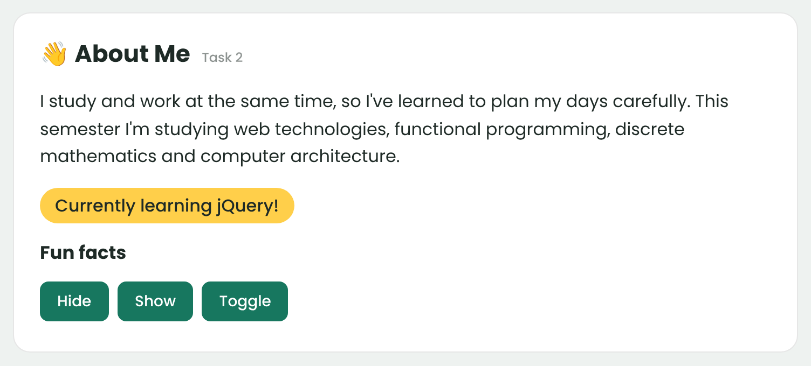

### Task 3. Fade Methods

**Task:**
- Display at least two images (profile picture, favorite hobby, travel photos, or personal projects).
- Use `.fadeIn()`, `.fadeOut()`, `.fadeToggle()` effects to control the visibility of gallery images.

**What I did:** the gallery has three images: my profile picture, my hobby and my project. The buttons **Fade In**, **Fade Out** and **Fade Toggle** work with `.gallery img` (all images inside the gallery). The effect takes 800 milliseconds.

```js
$("#fadein-btn").click(function () {
  $(".gallery img").fadeIn(800);
});
$("#fadeout-btn").click(function () {
  $(".gallery img").fadeOut(800);
});
$("#fadetoggle-btn").click(function () {
  $(".gallery img").fadeToggle(800);
});
```

**Screenshots:**

Before:

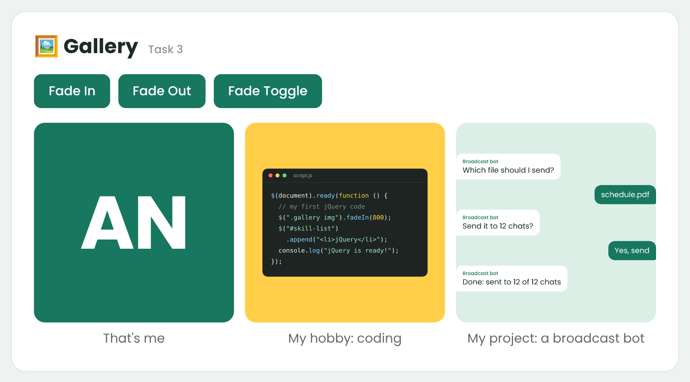

After clicking **Fade Out**:

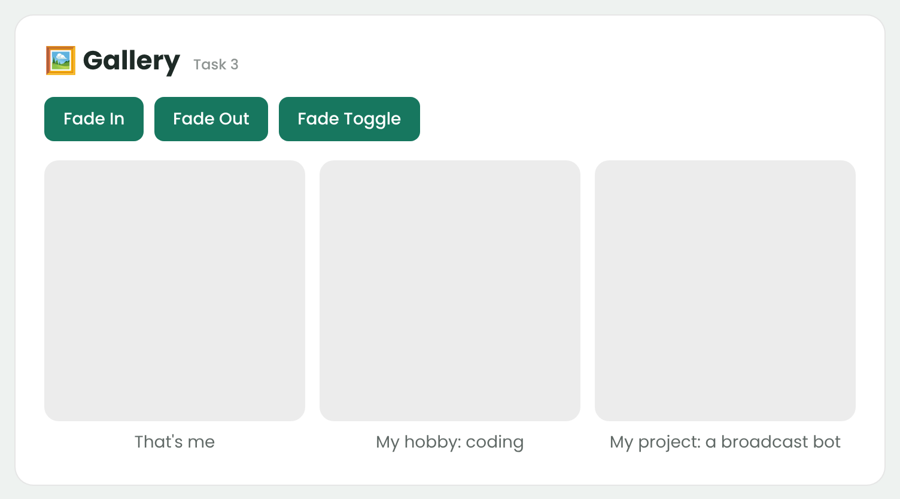

### Task 4. Slide Methods

**Task:**
- Create at least three clickable headings, such as "My Favorite Music," "My Favorite Movie," and "My Favorite Subject."
- Place related information inside a collapsible panel beneath each heading.
- Use `.slideUp()`, `.slideDown()`, `.slideToggle()` to make the interaction smooth.

**What I did:** there are three clickable headings with a hidden text block under each one. When I click a heading, `$(this).next()` finds the block right after it and `.slideToggle()` opens or closes it. **Open All** uses `.slideDown()` and **Close All** uses `.slideUp()`.

```js
$(".fav-title").click(function () {
  $(this).next().slideToggle();
});
$("#open-btn").click(function () {
  $(".fav-text").slideDown();
});
$("#close-btn").click(function () {
  $(".fav-text").slideUp();
});
```

**Screenshots:**

After clicking **My Favorite Movie**:

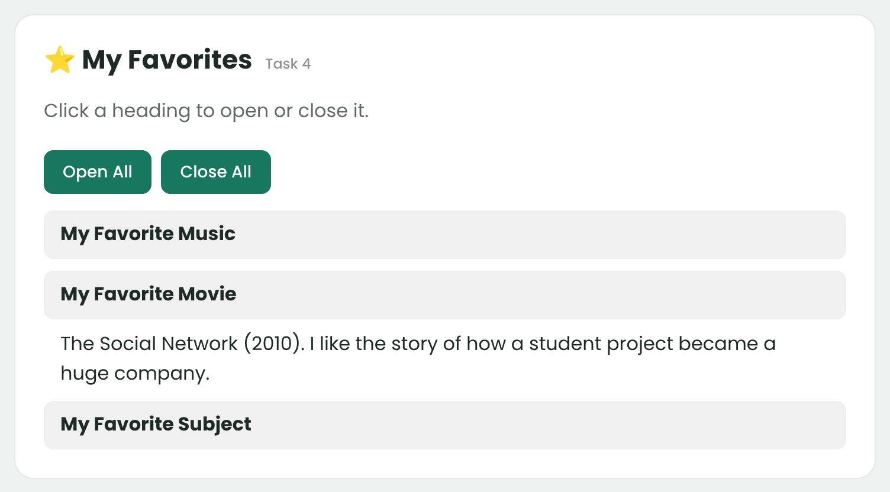

After clicking **Open All**:

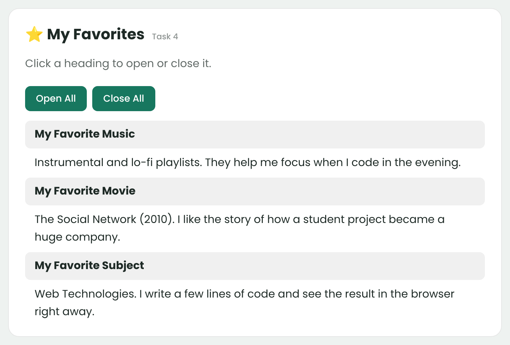

---

## Part 3. DOM Manipulation with jQuery

### Task 5. Add & Remove Elements

**Task:**
- Display an initial list containing at least four technical skills.
- Add a text input where visitors can enter a new skill.
- Create three buttons: "Add Skill," "Prepend Skill," and "Remove Skill."
- Use `.append()`, `.prepend()`, `.remove()`.
- Prevent empty skills from being added.

**What I did:** the list starts with five skills. **Add Skill** adds a skill to the end with `.append()`, **Prepend Skill** adds it to the start with `.prepend()`, **Remove Skill** removes the last skill with `.remove()`. The input value is read with `.val()`, and `.trim()` removes extra spaces. If the input is empty, the skill is not added and an error message appears.

```js
$("#add-btn").click(function () {
  let skill = $("#skill-input").val().trim();
  if (skill === "") {
    $("#skill-error").text("Please type a skill first.");
    return;
  }
  $("#skill-error").text("");
  $("#skill-list").append("<li>" + skill + "</li>");
  $("#skill-input").val("");
});

// Prepend Skill is the same, but with .prepend()

$("#remove-btn").click(function () {
  $("#skill-list li").last().remove();
});
```

**Screenshots:**

Clicking **Add Skill** with an empty input:

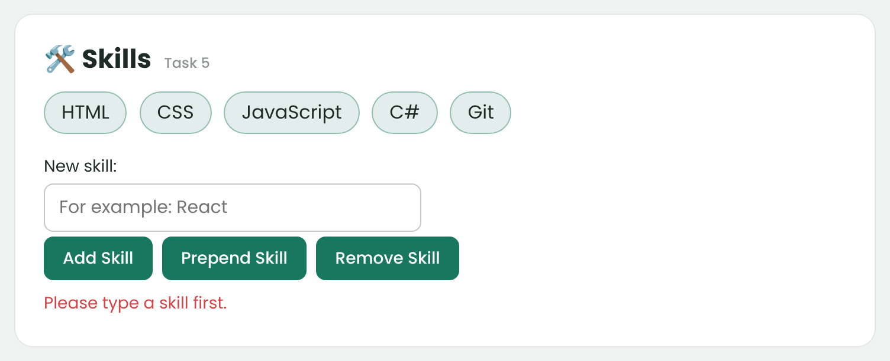

After adding "React" with **Add Skill** and "TypeScript" with **Prepend Skill**:

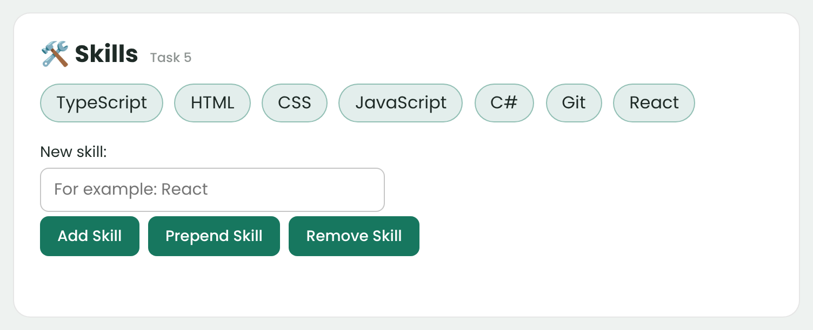

After clicking **Remove Skill** ("React" was the last skill, so it was removed):

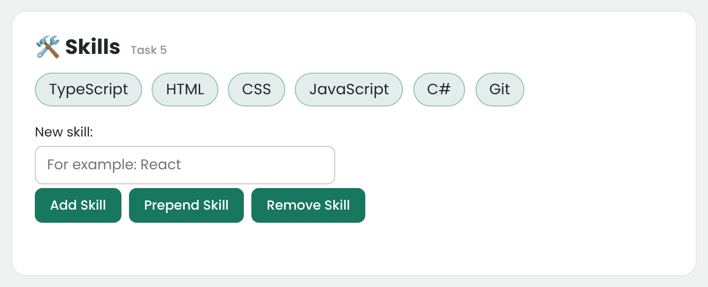

### Task 6. Modifying Attributes

**Task:**
- Add a social media link, such as GitHub, LinkedIn, or a personal website.
- Create a button that dynamically changes the link's destination using `.attr()`.

**What I did:** there is a link to my GitHub. The **Change Link** button checks the current link with `.attr("href")` and changes it with `.attr("href", newLink)`: GitHub becomes my university website, and the next click changes it back. The current link is shown under it.

```js
$("#link-btn").click(function () {
  if ($("#social-link").attr("href") === githubLink) {
    $("#social-link").attr("href", universityLink);
    $("#social-link").text("My University");
  } else {
    $("#social-link").attr("href", githubLink);
    $("#social-link").text("My GitHub");
  }
  $("#link-info").text("Current link: " + $("#social-link").attr("href"));
});
```

**Screenshots:**

Before:

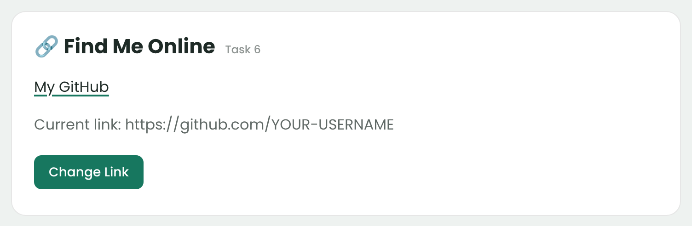

After clicking **Change Link**:

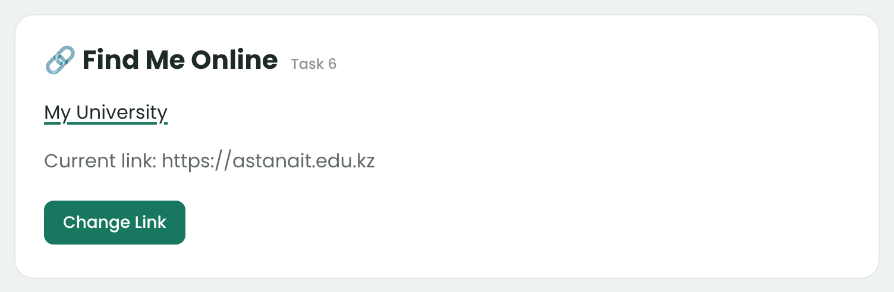

### Task 7. Form Interaction

**Task:**
- Create a form with inputs for Name and Email.
- When the user types, display their input live below the form using `.val()` and `.text()`.

**What I did:** the form has Name and Email inputs. On every `keyup` (when a key is released) I read the input with `.val()` and show it below the form with `.text()`.

```js
$("#name-input").keyup(function () {
  $("#name-preview").text($(this).val());
});
$("#email-input").keyup(function () {
  $("#email-preview").text($(this).val());
});
```

**Screenshot:**

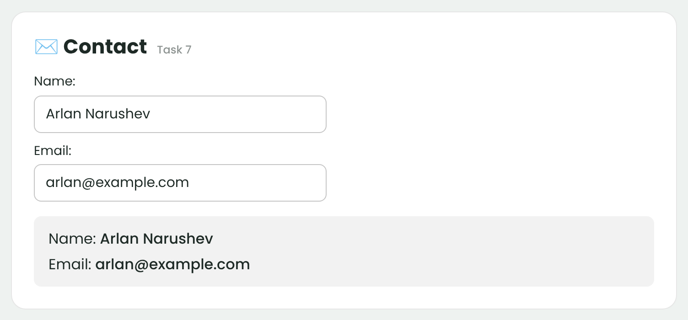

---

## Part 4. Animations

### Task 8. Basic Animation

**Task:**
- Extend Task 5 by creating a visual representation of at least three technical skills using skill bars.
- Add an "Animate My Skills" button.
- Initially, the skill bars should have zero width.
- When the button is clicked, use jQuery's `.animate()` method to increase the width of each skill bar.
- Use different target widths to represent different skill levels.
- When the button is clicked again, animate the skill bars back to zero width.

**What I did:** the Skill Levels block is right after the Skills block. It has four bars with `width: 0` in CSS. The variable `barsFull` remembers if the bars are full. On the first click every bar grows to its own width with `.animate()` (85%, 65%, 60%, 50%). On the next click all bars go back to `0%`.

```js
let barsFull = false;

$("#animate-btn").click(function () {
  if (barsFull === false) {
    $("#bar-html").animate({ width: "85%" }, 1000);
    $("#bar-js").animate({ width: "65%" }, 1000);
    $("#bar-jquery").animate({ width: "60%" }, 1000);
    $("#bar-csharp").animate({ width: "50%" }, 1000);
    barsFull = true;
  } else {
    $(".bar-fill").animate({ width: "0%" }, 1000);
    barsFull = false;
  }
});
```

**Screenshots:**

Before (zero width):

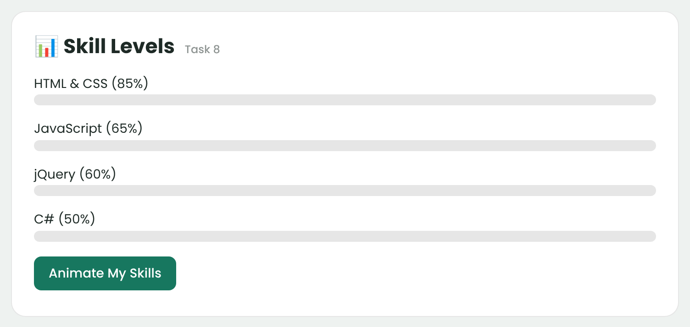

After clicking **Animate My Skills**:

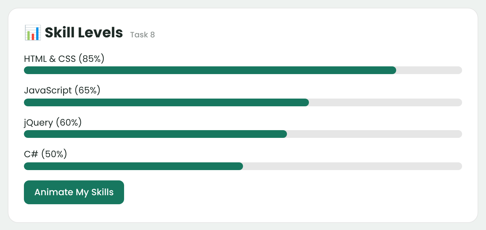

---

## Summary of the work process

First I made the HTML structure: one block (card) for every task. Then I wrote the CSS: simple cards, a green colour for buttons and a yellow badge for the status. After that I connected jQuery from the CDN and checked in the console that `$(document).ready()` works. Then I wrote the jQuery code task by task, from selectors to animation, and checked every button in the browser after each task. I also checked the edge cases: an empty skill or a skill with only spaces is not added, and the dark theme works for all blocks. At the end I took the screenshots, wrote this README and published the site on GitHub Pages.
